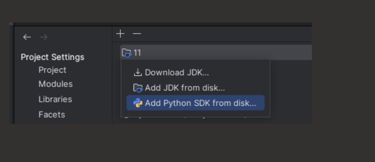
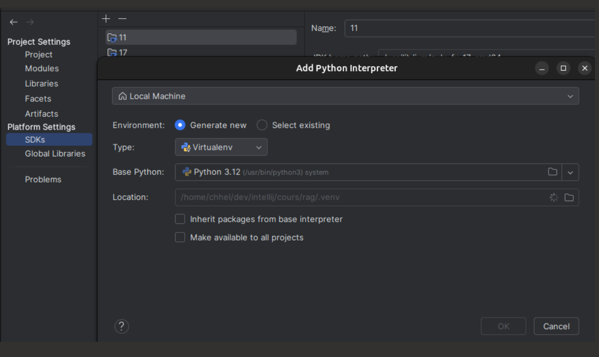
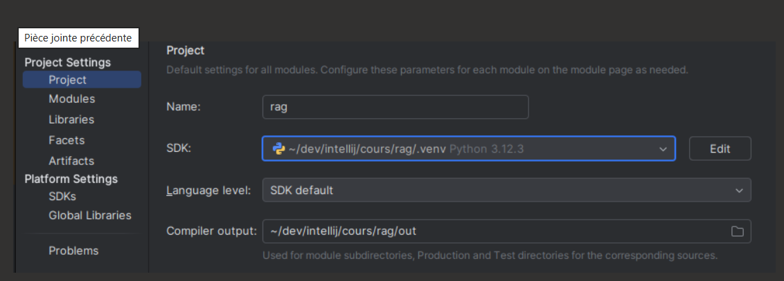

# TP RAG sur des datasheets de composants

Un RAG (*retrieval-augmented generation*) minimal, dans un seul fichier Python.
Pas de framework, pas de base vectorielle : PDF → chunks → embeddings → index numpy → top-k → LLM.

## Prérequis

- [Git](https://git-scm.com/downloads)
- [Python](https://www.python.org/downloads/) ≥ 3.11
- [IntelliJ IDEA](https://www.jetbrains.com/idea/download/) avec le plugin **Python**
  (*Settings → Plugins → Marketplace → Python*)

## Installation avec IntelliJ

1. **Récupérer le projet** : *File → New → Project from Version Control*,
   URL `https://github.com/jlurton/rag.git`, puis *Clone*.

2. **Créer l'environnement virtuel** : *File → Project Structure → Platform Settings → SDKs*,
   bouton **+** → *Add Python SDK from disk…*

   

   Dans la fenêtre *Add Python Interpreter* :
   - *Environment* : **Generate new**
   - *Type* : **Virtualenv**
   - *Base Python* : votre Python ≥ 3.11
   - *Location* : `<dossier du projet>/.venv`
   - *OK* — IntelliJ crée le dossier `.venv/`.

   

3. **Activer le venv pour le projet** : toujours dans *Project Structure*, aller dans
   *Project Settings → Project* et choisir le SDK qui vient d'être créé
   (`<dossier du projet>/.venv`) dans la liste *SDK*, puis *OK*.
   Sans cette étape, le projet reste sur le JDK par défaut et Python n'est pas reconnu.

   

4. **Installer les dépendances** : ouvrir `requirements.txt`.
   IntelliJ propose une bannière *Install requirements* en haut du fichier : cliquer dessus.
   (Sinon, dans le terminal intégré — *View → Tool Windows → Terminal*, qui active `.venv`
   automatiquement — lancer `pip install -r requirements.txt`.)

5. **Télécharger les datasheets** : clic droit sur `download_data.py` → *Run 'download_data'*.
   Les PDF arrivent dans `data/`.

6. **Renseigner la clé d'API** : copier `.env.example` en `.env`
   (clic droit sur le fichier → *Copy*, puis *Paste*), et y mettre la clé fournie dans `LLM_API_KEY`.

7. **Vérifier que tout est prêt** : clic droit sur `check_setup.py` → *Run 'check_setup'*.
   Le script contrôle, dans l'ordre, la version de Python, la clé, le corpus, le modèle
   d'embeddings (~500 Mo téléchargés au premier lancement) et un appel au LLM ;
   il s'arrête à la première vérification qui échoue (sans clé dans `.env`, il s'arrête donc
   dès l'étape 2).

8. **Ouvrir le premier notebook** : `tp1_retrieval.ipynb`.
   IntelliJ démarre le serveur Jupyter tout seul ; vérifier en haut à droite du notebook
   que l'interpréteur sélectionné est bien celui du projet (`.venv`).

## Installation en ligne de commande (alternative)

```bash
git clone https://github.com/jlurton/rag.git && cd rag
python -m venv .venv
source .venv/bin/activate        # Windows : .venv\Scripts\activate
pip install -r requirements.txt
python download_data.py          # télécharge les datasheets dans data/
cp .env.example .env             # puis renseigner LLM_API_KEY dans .env
python check_setup.py            # vérifie Python, clé, corpus, embeddings, appel LLM
jupyter lab                      # ouvre les notebooks
```

## Corrigés

Le dossier `solutions/` est vide au départ : les corrigés sont fournis **à la fin de chaque TP**,
un fichier par TP (`tp1.py`, `tp2.py`, `tp3.py`). Déposez-les dans ce dossier, sans les renommer.

Pourquoi ? Le TP2 et le TP3 réutilisent des fonctions du TP1 (recherche hybride, découpage par paragraphes).
Ils les importent depuis `solutions/tp1.py` : si vous n'avez pas terminé le TP1, vous pouvez continuer quand même.

Vous préférez vos propres fonctions ? Collez-les sous l'import, dans la cellule concernée : elles remplacent celles
du corrigé.
